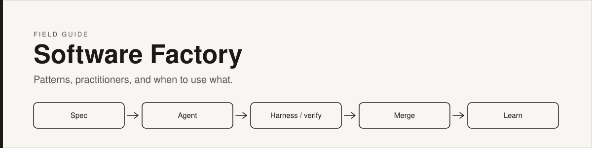
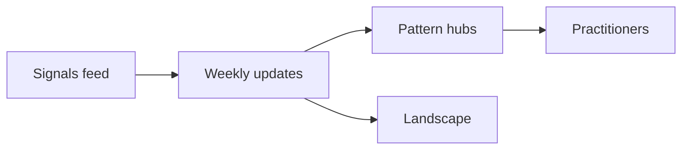
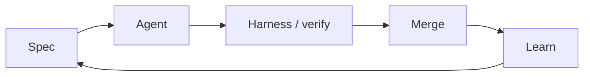

# Software Factory

  

  

A research corpus on agent-native software delivery: how teams wire coding agents, what they verify before merge, and which topologies show up in production. Pattern hubs hold the mechanisms. Practitioner profiles hold the cited team record. Dated surveys are archived snapshots; [landscape](docs/landscape/README.md) is the current state of play. Agents parse [`docs/index.json`](docs/index.json).

## Start here

- [When to use what](AGENTS.md#when-to-use-what) — decision map
- [Practitioners](docs/practitioners/README.md) — 79 profiles in six categories
- [Patterns](docs/patterns/) — mechanism hubs
- [X insights](docs/signals/x-insights.md) — weekly updates

## How the repo is organized

## When to use what

| Situation | Pattern |
| --- | --- |
| Many independent, well-scoped tasks | [Background agents](docs/patterns/background-agents/README.md) |
| Humans join one sandbox mid-flight | [Background agents](docs/patterns/background-agents/README.md) |
| Same model, weak results | [Harness engineering](docs/patterns/harness-engineering/README.md) |
| Clear done-signal, scope creep is the risk | [Verification](docs/patterns/verification/README.md) |
| CI latency blocks agent throughput | [Verification](docs/patterns/verification/README.md) |
| Several agents need budget, locks, or a lifecycle | [Orchestration](docs/patterns/orchestration/README.md) |
| Spend or blast radius can run away | [Governance and safety](docs/patterns/governance-safety/README.md) |
| The window is full, or the next run must remember | [Memory and knowledge](docs/patterns/memory-knowledge/README.md) |
| An objective metric should keep a loop running | [Self-improvement](docs/patterns/self-improvement/README.md) |
| You need the current market map | [Landscape](docs/landscape/README.md) |
| You need an archived production survey | [Case studies](docs/case-studies/README.md) |

## Practitioners

79 profiles. Citations live in the [catalog](docs/practitioners/README.md).

| Category | Profiles |
| --- | --- |
| Enterprise in-house factories | 20 |
| Coding-agent vendors | 30 |
| Open-source agents | 11 |
| Infra and sandboxes | 9 |
| Review and verification | 5 |
| Orchestration | 4 |

## The loop

Lookup: [key numbers](docs/reference/key-numbers.md) · [glossary](docs/reference/glossary.md) · [project](docs/project/README.md). [MIT License](LICENSE).
