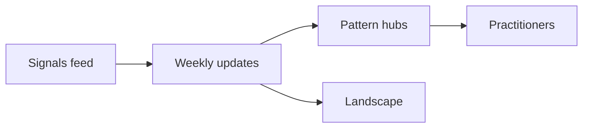
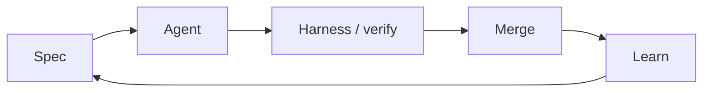

# Software Factory

  

  

A research corpus on agent-native software delivery: how teams wire coding agents, what they verify before merge, and which topologies show up in production. Pattern hubs hold the mechanisms. Practitioner profiles hold the cited team record. Dated surveys are archived snapshots; [landscape](docs/landscape/README.md) is the current state of play. Agents parse [`docs/index.json`](docs/index.json).

## Start here

- [When to use what](AGENTS.md#when-to-use-what) — decision map
- [Practitioners](docs/practitioners/README.md) — one profile per team
- [Patterns](docs/patterns/) — mechanism hubs
- [X insights](docs/signals/x-insights.md) — weekly updates

## How the repo is organized

## When to use what

| Situation | Pattern |
| --- | --- |
| Many independent, well-scoped tasks | [Background agents](docs/patterns/background-agents/README.md) |
| Humans join one sandbox mid-flight | [Background agents](docs/patterns/background-agents/README.md) |
| Same model, weak results | [Harness engineering](docs/patterns/harness-engineering/README.md) |
| Clear done-signal, scope creep is the risk | [Verification](docs/patterns/verification/README.md) |
| CI latency blocks agent throughput | [Verification](docs/patterns/verification/README.md) |
| Several agents need budget, locks, or a lifecycle | [Orchestration](docs/patterns/orchestration/README.md) |
| Spend or blast radius can run away | [Governance and safety](docs/patterns/governance-safety/README.md) |
| The window is full, or the next run must remember | [Memory and knowledge](docs/patterns/memory-knowledge/README.md) |
| An objective metric should keep a loop running | [Self-improvement](docs/patterns/self-improvement/README.md) |
| You need the current market map | [Landscape](docs/landscape/README.md) |
| You need an archived production survey | [Case studies](docs/case-studies/README.md) |

## Practitioners

<table>
<tr><td><a href="docs/practitioners/stripe-minions.md"><strong>Stripe Minions</strong></a> One-shot coding devboxes</td><td><a href="docs/practitioners/spotify-honk.md"><strong>Spotify Honk</strong></a> Fleet jobs and judge</td><td><a href="docs/practitioners/ramp-inspect.md"><strong>Ramp Inspect</strong></a> Snapshot sandbox sessions</td><td><a href="docs/practitioners/open-inspect.md"><strong>Open-Inspect</strong></a> Open source Inspect clone</td></tr>
<tr><td><a href="docs/practitioners/openai-codex.md"><strong>OpenAI Codex</strong></a> Harness-built internal product</td><td><a href="docs/practitioners/strongdm-software-factory.md"><strong>StrongDM Software Factory</strong></a> Specs drive the agents</td><td><a href="docs/practitioners/cognition-devin.md"><strong>Cognition Devin</strong></a> Cloud autonomous engineer</td><td><a href="docs/practitioners/langchain-deep-agents.md"><strong>LangChain Deep Agents</strong></a> Harness-only benchmark gains</td></tr>
<tr><td><a href="docs/practitioners/anthropic-claude-code.md"><strong>Anthropic Claude Code</strong></a> Terminal agent and skills</td><td><a href="docs/practitioners/amp.md"><strong>Amp</strong></a> Closes the reporter loop</td><td><a href="docs/practitioners/vercel.md"><strong>Vercel</strong></a> Agentic CI infrastructure</td><td><a href="docs/practitioners/replit-agent-habitat.md"><strong>Replit Agent Habitat</strong></a> Contained space for agents</td></tr>
<tr><td><a href="docs/practitioners/openhands.md"><strong>OpenHands</strong></a> Open source sandbox agents</td><td><a href="docs/practitioners/goose.md"><strong>Goose</strong></a> Block open source agent</td><td><a href="docs/practitioners/cline.md"><strong>Cline</strong></a> Asks before it acts</td><td><a href="docs/practitioners/paperclip.md"><strong>Paperclip</strong></a> Org chart and budgets</td></tr>
<tr><td><a href="docs/practitioners/composio-agent-orchestrator.md"><strong>Composio Agent Orchestrator</strong></a> One worktree per agent</td></tr>
</table>

## The loop

Lookup: [key numbers](docs/reference/key-numbers.md) · [glossary](docs/reference/glossary.md) · [project](docs/project/README.md). [MIT License](LICENSE).
